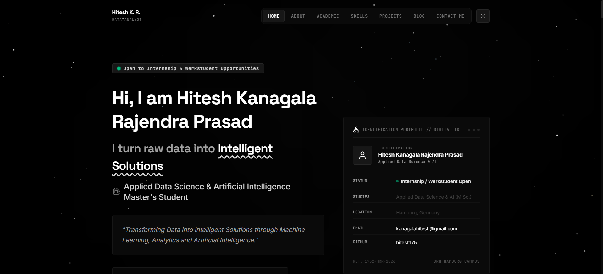

# Hitesh — Personal Portfolio

A React and TypeScript portfolio presenting projects, skills, education, certificates, and research interests.



## Technology

React 19, TypeScript, Vite, Tailwind CSS, Motion, and Lucide icons.

## Local development

Install Node.js and npm, then run from the repository root:

```bash
npm install
npm run dev
```

The development script serves the app at `http://localhost:3000`.

## Checks and build

```bash
npm run lint
npm run build
npm run preview
```

The `lint` script runs TypeScript type checking. The production build is written to `dist/`; the preview command serves that build locally.

A package lockfile is not currently committed, so dependency resolution can vary between installs.

## Project guide

| Path | Purpose |
| --- | --- |
| [src/App.tsx](src/App.tsx) | Main application |
| [src/components](src/components/) | Portfolio sections and interface components |
| [src/data.ts](src/data.ts) | Portfolio data |
| [src/index.css](src/index.css) | Shared styling |
| [public](public/) | Public assets and search-engine metadata |
| [vite.config.ts](vite.config.ts) | Development and build configuration |

## Publishing checklist

Review personal details and project claims, test navigation and contact interactions, then build and deploy `dist/` to a static host. Check the sitemap, canonical URLs, and preview image against the destination domain.

The repository tracks an environment file. Keep real credentials out of source control and browser-delivered code.
