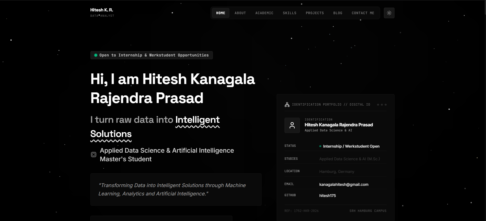

# Hitesh — Personal Portfolio

A React and TypeScript portfolio presenting projects, skills, education, certificates, and research interests.



## Technology

React 19, TypeScript, Vite, Tailwind CSS, Motion, and Lucide icons.

The current visual direction adapts [MotionSites Portfolio Cosmic](https://motionsites.ai/?prompt=portfolio-cosmic-hero): a cinematic monochrome hero, Instrument Serif display typography, floating navigation and an asymmetric project gallery. See `DESIGN.md` for the implemented system and `ASSETS.md` for the reference and asset sources. The motion background can be paused and remains static for reduced-motion preferences. Its streaming player and project demos load separately from the initial application bundle.

## Local development

Install Node.js and npm, then run from the repository root:

```bash
npm ci
npm run dev
```

The development script serves the app at `http://localhost:3000`.

## Checks and build

```bash
npm run lint
npm run build
npx playwright install chromium
npm test
npm run preview
```

The `lint` script runs TypeScript type checking. The production build is written to `dist/`; the preview command serves that build locally.

The lockfile pins dependencies. The build generates `public/Hitesh_Kanagala_CV.pdf` from the same `src/data.ts` content used on the website, then checks types and builds the site. Preview and download use this same PDF. Update the supplied portfolio content before publishing if any facts need changing.

Browser tests mock message delivery; they never send a real email. They cover failed delivery and retry, dialog focus and Escape, article links, chart updates, labels, and 320/390/768/1440px layouts in both themes. On Windows with Edge installed, set `PLAYWRIGHT_EDGE=1` to use Edge instead of downloading Chromium. Set `PLAYWRIGHT_BASE_URL` to test a running local server.

Contact sending requires `VITE_WEB3FORMS_ACCESS_KEY` in the deployment environment. Without it, the form explains that sending is unavailable and offers direct email. Failed requests preserve entered text. No message history is retained in the visitor's browser. The Web3Forms access key is a browser-facing form key, not a server secret.

Interactive demonstrations use generated data. Their example scores and financial figures are illustrative, and are labelled accordingly; they are not measured results from the linked project repositories.

## Project guide

| Path | Purpose |
| --- | --- |
| [src/App.tsx](src/App.tsx) | Main application |
| [src/components](src/components/) | Portfolio sections and interface components |
| [src/data.ts](src/data.ts) | Portfolio data |
| [src/index.css](src/index.css) | Shared styling |
| [public](public/) | Public assets and search-engine metadata |
| [vite.config.ts](vite.config.ts) | Development and build configuration |

## Publishing checklist

Review personal details and project claims, test navigation and contact interactions, then build and deploy `dist/` to a static host. Check the sitemap, canonical URLs, and preview image against the destination domain.

The repository tracks an environment file. Keep real credentials out of source control and browser-delivered code.

Project covers use project-specific Lucide application icons in a uniform grid: three columns on wide desktop screens, two on tablet widths, and one on phones. Cards and icon areas have matching dimensions. Rejected image assets are archived under `output/project-renders/rejected-v1/` and are not served by the site.
